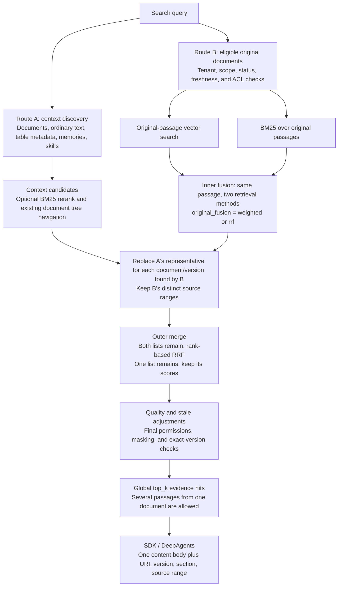

# Document retrieval: source evidence, two routes, and fusion

Last reviewed: 2026-11-06 (Asia/Hong_Kong).

This is the maintained design and implementation overview for document retrieval.
It describes source storage, retrieval routes, score fusion, and evidence delivery.
Operational details belong in
[Document section generation](../setup/document-section-generation.md).
The validation summary below distinguishes automated regression checks from
limited historical retrieval comparisons; full experiment records are archived
separately and are not runtime or test dependencies.

## The central idea

Document discovery and evidence discovery are different jobs. A document's
introduction can help find the document, but a useful original passage must also
be discoverable without first matching that introduction.

There are two retrieval routes and two distinct fusion steps. The **inner fusion**
combines vector and BM25 evidence for original passages. The **outer merge**
combines those passage results with remaining context-level results, only when
both lists remain after replacing duplicate document representatives.



The arrows show logical dependencies, not parallel execution. Query embedding
is shared between the two vector searches. Permissions are checked before
source-file access as well as before delivery. The diagram describes ordinary
evidence retrieval; explicit `level="L0"` discovery still deduplicates by document.

## Storage and evidence boundaries

The retrieval unit follows the source and task, not a universal character-count
threshold. An independently identified benchmark passage can be an ordinary
context. A complete article needing internal navigation can be a document, even
without headings. A short complete article does not require a chapter tree.

| Content | Stored layers and structure | What can be searched |
|---|---|---|
| Independent short text | L0/L1 may be NULL; inline L2 contains the original. | The original supplies the context discovery embedding when L0/L1 are absent. |
| File-backed document | One document row holds L0 and optional L1. Full extracted L2 is in `extracted.txt`, alongside the source asset and extracted Markdown. Sections store titles, hierarchy, descriptions and source offsets. | Document discovery plus independent original-passage vectors and BM25. |
| Table metadata | Uses its schema/catalog representation and structured metadata path. | Context-level schema discovery; business records remain in their source system. This is not the document-passage route. |

For documents, L0 is a document introduction reused from the existing combined
generation call. When generation is unavailable, skipped or fails, it is the
explicit metadata label `Document: <source filename stem>`, not a truncated body
presented as a summary. L1 is rendered by code from reliable source headings,
saved section IDs and source ranges. Without recognized headings, L1 is NULL;
sequential reading ranges still exist. A separate table of contents is unnecessary.

L0/L1 are **not copied into every passage**. `document_chunk_embeddings` stores
vectors and document/version/range identity, section ID and source hash, rather
than repeated bodies or summaries. Its embedding input is the source title path
plus the exact original slice. Generated section descriptions are not inputs to
this vector route or original-text BM25. They remain part of the existing tree
navigation path; their generation has not been removed by these changes.

The shared range builder follows stored section boundaries. A section fitting
the 4,000-character body limit stays whole. Larger sections descend into children,
then split by paragraphs, sentences and whitespace; only an oversized unbroken
run needs a hard character cut. Parent introductions remain searchable. Sibling
chapters are not combined, and parent/child bodies do not produce overlapping
copies. The limit counts characters, not model tokens.

For a located file-backed evidence hit, search leaves the repeated L0/L1/L2 body
fields empty and returns the original snippet. DeepAgents emits one `content`
body with URI, version, section ID and `snippet_offset=[start,end)`. Offsets refer
to the unmasked extracted original, even if delivery masking changes its length.
Document and section reads retain the ability to fetch the original evidence.

## What each route does

**Route A finds context records.** Its historical `contexts.l0_embedding` column
contains the discovery embedding of `L0 or L1 or L2`, so raw-only ordinary text
does not require a summary. With query embeddings available it recalls context
candidates by vector similarity; without them it uses the existing context
keyword fallback. The configured reranker can score candidates with BM25 on
L1, falling back to L0 or snippet. Already recalled file-backed documents can
then use the existing tree selector to choose a representative passage.

**Route B finds original passages directly.** It starts from all eligible,
ACL-visible file-backed resource documents, independently of A's candidates.
Vector discovery searches stored passage vectors; BM25 scores the original
ranges themselves. Both use document versions and source locations, and stored
vector hits are checked against the source hash before materialization.

Original BM25 reuses `bm25_scores` with `k1=1.5` and `b=0.75`. Its document
frequency and average fragment length use **all ranges of all eligible documents
supplied to this search**, including zero-hit ranges, not only vector candidates or matching fragments.
English words/numbers match complete tokens; common Han characters are handled
individually. There is no stemming, topic extraction or model-generated keyword
list. Route A's reranker still has its own tokenizer and candidate-local corpus;
sharing the BM25 formula does not make these two scoring stages identical.

Vector candidate budgets remain `top_k * 3`. Original BM25 contributes every
positive-scoring range, so the combined candidate set can exceed that budget.
Final `top_k` is a limit on evidence hits, not a one-result-per-document quota.
API/SDK defaults are 10; the DeepAgents tool default and fixed sample use 5.

## Inner fusion: two methods scoring the same original passages

Candidates are the union of vector discoveries and positive BM25 matches, keyed
by document ID, version and exact source range. A range found twice is one hit;
different ranges of the same document remain distinct, even with the same section ID.

| `original_fusion` | Implemented rule |
|---|---|
| `weighted` (default) | Complete missing candidate cosine scores from existing stored vectors. Normalize each score route with `(score-min)/(max-min)` over the candidate union, then use `0.8 * normalized_cosine + 0.2 * normalized_bm25`. |
| `rrf` | Reciprocal rank fusion: sum `1/(60 + rank)` over the original vector and BM25 ranked discovery lists. Both routes have equal weight; absence from a list contributes zero. |

Weighted score completion adds no candidates and calls no model. A vector-only
candidate has BM25 zero because every positive lexical match was already emitted.
A candidate without a valid stored vector contributes no vector score and is
excluded from cosine min/max; its cosine is not fabricated as zero. A constant
or empty score route contributes no ranking distinction. RRF does not complete
cosine scores to create extra vector-list votes.

These are ranking policies, not relevance probabilities. The fixed 0.8/0.2
weights express a preference for vector scores; they do not guarantee that every
vector rank is preserved. Min/max normalization depends on the candidate set.
Neither policy has been established as universally better by the small replay.

The same per-request choice is exposed through HTTP, Python SDK and DeepAgents:

```python
await client.search(query, top_k=5, original_fusion="rrf")
await client.search(query, top_k=5, original_fusion="weighted")
```

Invalid values are rejected; the retrieval trace records the choice. This
parameter changes **only inner fusion**, not the outer merge. Weights, candidate
multiplier and RRF constant are not additional request parameters.

## Outer merge: remaining context hits versus original-passage hits

First remove A's representative for every document/version represented in B.
This prevents a document overview or tree-selected representative from competing
with its newly returned original ranges. Remaining A results may include
ordinary text, table metadata, memories, skills **and other resource documents**;
calling this only a merge with "other context types" is incomplete.

| Lists remaining after replacement | Current behavior |
|---|---|
| Only A | Keep A's scores. |
| Only B | Keep B's inner-fusion scores; do not apply another RRF. |
| Both A and B | Rank each list by its own score, then apply equal-weight RRF with constant 60. |

For the mixed case, the surviving lists are disjoint after document replacement.
In practice the outer RRF therefore behaves as rank-based interleaving:
A's first hit and B's first hit each receive `1/61`, their second hits each receive
`1/62`, and so on. They are not getting two votes for the same evidence.
Subsequent quality and stale adjustments can still affect final order.

This avoids comparing incompatible raw score scales, but discards score gaps
inside each route. Inner 0.8/0.2 determines B's ordering; it does **not** make B
80% of the final mixed result. The outer RRF is retained implementation behavior,
not a necessary architectural rule or an experimentally proven best choice.
The latest isolated Microarchitecture replays disabled A, so they do not validate
this mixed-list behavior's relevance.

## Validation and limitations

The earlier design used L0 vector discovery, L1 reranking and on-demand L2,
with source files and tree navigation for long documents. Direct original-passage
discovery removes the requirement to recall a document through L0 first.
The temporary HyDRA import that copied full text into all three layers was a
benchmark shortcut, not the intended document-ingestion design.

### Automated regression checks

The focused tests cover raw-only context creation and updates, reliable heading
ranges, passage indexing, source hashes and versions, full-corpus BM25, both
fusion choices, same-document passage retention, deduplication, ACL/masking, and
API/SDK/DeepAgents delivery. Test inputs and vectors are constructed in the tests;
the suite does not require benchmark datasets, archived outputs or model accounts.

PR validation on 2026-11-06: **248 passed, 2 database-dependent tests skipped**.

After installing the server, SDK and DeepAgents development dependencies, run
from the repository root:

```bash
CONTEXTHUB_INTEGRATION=0 PYTHONPATH=src:sdk/src:plugins/deepagents/src python -m pytest -q \
  tests/test_document_ingester.py tests/test_long_doc_retrieval.py \
  tests/test_openai_embedding_client.py tests/test_retrieval.py tests/test_sdk.py \
  tests/test_document_chunk_vectors.py tests/test_raw_context_retrieval.py \
  plugins/deepagents/tests/test_tools.py
```

Live-database tests remain opt-in. This command exercises mocked providers and
local temporary fixtures; it does not run a benchmark, rebuild an index or call
an embedding or answering provider.

### Historical sample evidence

Earlier isolated checks exercised a real short passage, structured and unstructured
articles, and a table description, including stored layers and exact source reads.
The combined document-generation check used a real provider; it did not add a
separate summary call. Source-anchor validity did not guarantee semantic accuracy
of generated section descriptions.

The later score-fusion comparison used one Microarchitecture document, 16 existing
passage vectors from `qwen3.7-text-embedding` at 1,536 dimensions, saved query vectors,
and `top_k=5`. Queries were `1986 VAX 8800` and
`How can a CPU make progress on several instructions at once by handling different stages simultaneously?`.

| Dedicated Instruction pipelining section | Vector-only rank | BM25 + RRF rank | Fixed weighted rank |
|---|---|---|---|
| Exact name/year query | 5 (returned) | 1 (returned) | 3 (returned) |
| Semantic paraphrase | 2 (returned) | 7 (outside top 5) | 2 (returned) |

The semantic RRF result still contained pipeline evidence in *Aspects of
microarchitecture*. Weighted fusion restored the dedicated chapter but put
*See also* first for the exact query. This is a tradeoff, not a general victory
for vector-only retrieval or either fusion policy. These passage-only replays
disabled route A, so they do not validate the outer merge's relevance.

The later BM25 and fusion replays used no new provider calls or index rebuilds.
No answering model was run in those replays; character and BM25 token counts
are not actual model usage or evidence of token/cost savings. Corpus-wide recall,
answer accuracy and large-corpus latency remain unevaluated by these checks.

The original reports, complete Agent bodies, provider usage and replay scripts are
preserved in the author's separate experiment archive at immutable commit
`8ef799ee82d1cff1abdd8a6f49d4266554f58a01`:
[document-layer check](https://github.com/heathersherry/ContextHub/blob/8ef799ee82d1cff1abdd8a6f49d4266554f58a01/docs/hydrabench/2026-11-05-DOCUMENT-LAYERS-QWEN38-27B.md),
[score-fusion comparison](https://github.com/heathersherry/ContextHub/blob/8ef799ee82d1cff1abdd8a6f49d4266554f58a01/docs/hydrabench/2026-11-06-WEIGHTED-FUSION.md),
and [API/SDK/tool replay](https://github.com/heathersherry/ContextHub/blob/8ef799ee82d1cff1abdd8a6f49d4266554f58a01/docs/hydrabench/2026-11-06-FUSION-SELECTION.md).
Those artifacts document historical observations; maintaining or running this
feature does not require checking out the archive.

## Calls, indexes, and implementation ownership

Source parsing, L1 rendering, BM25, score completion and both fusion policies add
no chat-model calls. L0 reuses the existing combined document-generation call;
this does not make ingestion model-free. Passage indexing adds embedding inputs
using the existing batch client. Search reuses one query embedding for A and B;
the existing A-side tree selector can still make its original model calls.

Changing L0 changes the discovery embedding input. Changing passage ranges or
their title-plus-body input requires corresponding passage embeddings. Changing
the embedding model or dimension requires a consistently embedded, isolated
index. BM25 or fusion changes alone require none of these rebuilds. Migration
`011` adds the passage table/index but does not backfill historical documents.
L1 display-only changes need no re-embedding when indexed ranges and titles stay
the same. Old experiments and indexes must not be silently migrated or overwritten.

| Responsibility | Implementation entry point |
|---|---|
| Document layers and reliable source structure | [document_ingester.py](../../src/contexthub/services/document_ingester.py) |
| Shared ranges and embedding input; separate passage storage | [ranges.py](../../src/contexthub/retrieval/long_doc/ranges.py), [document_chunk_indexer.py](../../src/contexthub/services/document_chunk_indexer.py) |
| Original BM25 and stored passage vectors | [keyword_retriever.py](../../src/contexthub/retrieval/long_doc/keyword_retriever.py), [vector_retriever.py](../../src/contexthub/retrieval/long_doc/vector_retriever.py), [shared BM25](../../src/contexthub/retrieval/rerank.py) |
| Inner fusion | `LongDocRetrievalCoordinator.search_originals` in [coordinator.py](../../src/contexthub/retrieval/long_doc/coordinator.py) |
| Route eligibility, outer merge, global top_k and delivery checks | `RetrievalService.search`, `_search_document_originals`, `_fuse_original_hits` in [retrieval_service.py](../../src/contexthub/services/retrieval_service.py) |
| Request choice and Agent content | [search model](../../src/contexthub/models/search.py), [SDK client](../../sdk/src/contexthub_sdk/client.py), [DeepAgents tools](../../plugins/deepagents/src/contexthub_deepagents/tools.py) |

## Open questions for the next discussion

- Does A's document-summary/tree route add useful evidence beyond B, and is its
  remaining model cost justified? No route removal has been decided.
- How should surviving A and B results compete? Outer equal-rank interleaving
  is not evaluated by the isolated B-only replays. Keep this question separate
  from the choice between inner RRF and weighted scores.
- Which inner fusion policy holds up on independent queries and documents?
  The current two queries cannot establish an optimal weight or default.
- When corpus size warrants it, should source BM25 use a persisted inverted
  index? It currently scans eligible files and computes statistics in memory.
  English inflections and Chinese word segmentation also remain limitations.

For each follow-up, identify the route and stage being changed, preserve query,
source/version/range and embedding provenance, and record the candidate set,
scores, final Agent bodies and actual provider calls. Update this overview when
behavior changes, keep validation conclusions concise, and retain detailed runs
in a separate experiment archive. Benchmark answers or reference reasoning must
never become index content.
